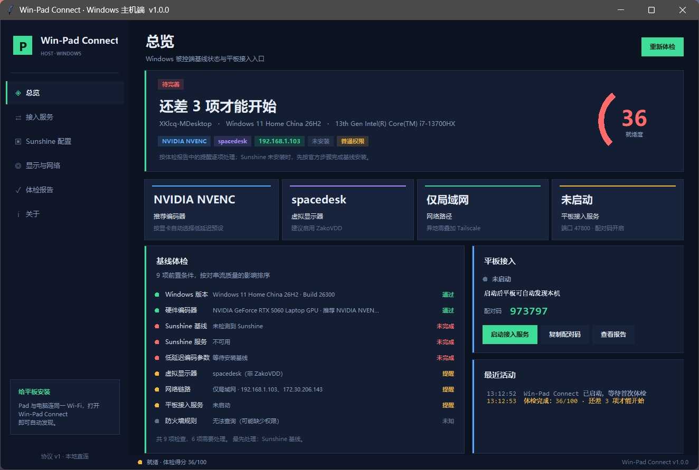
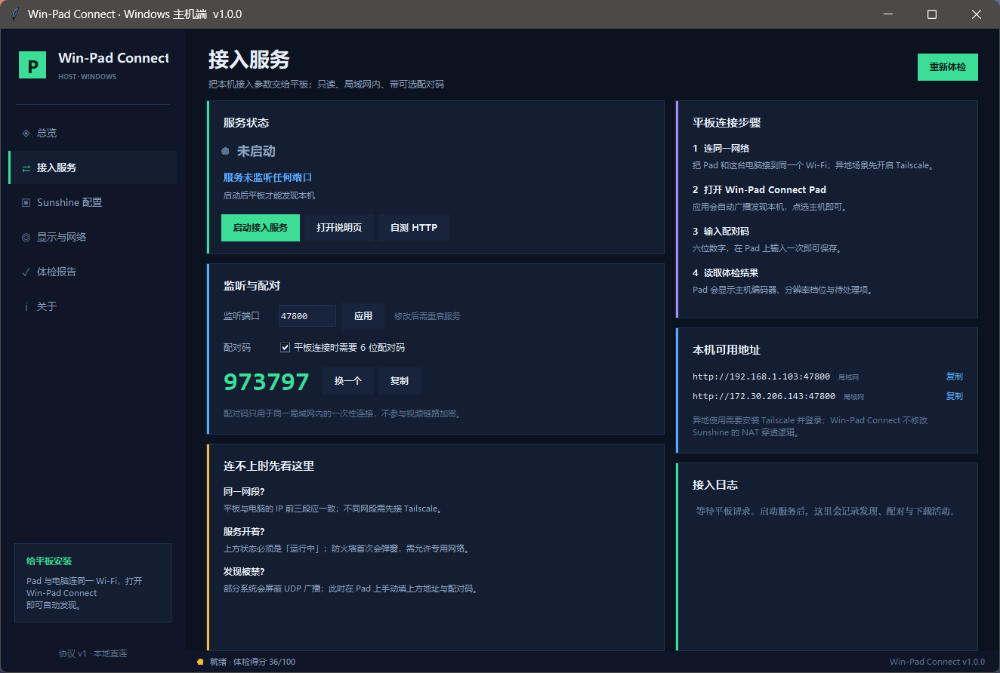
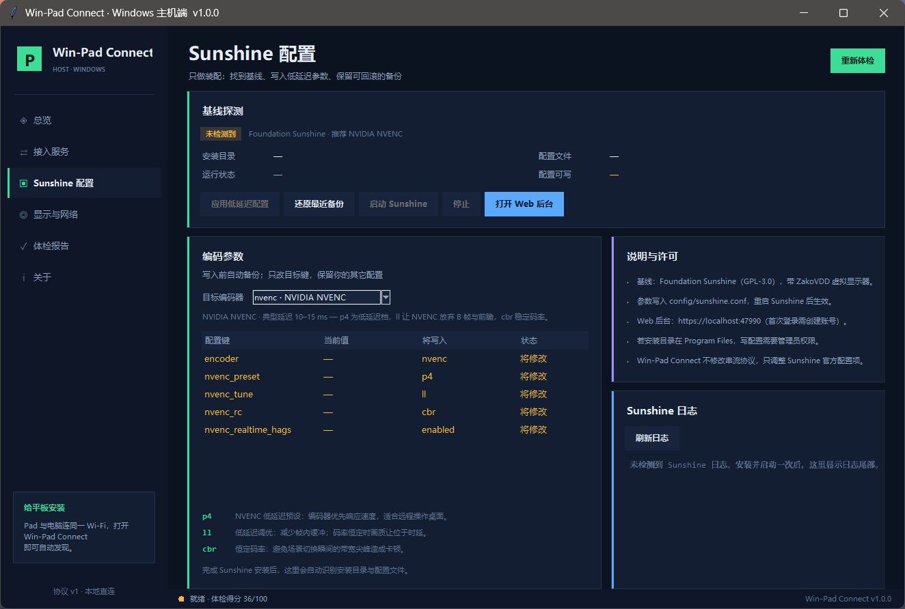
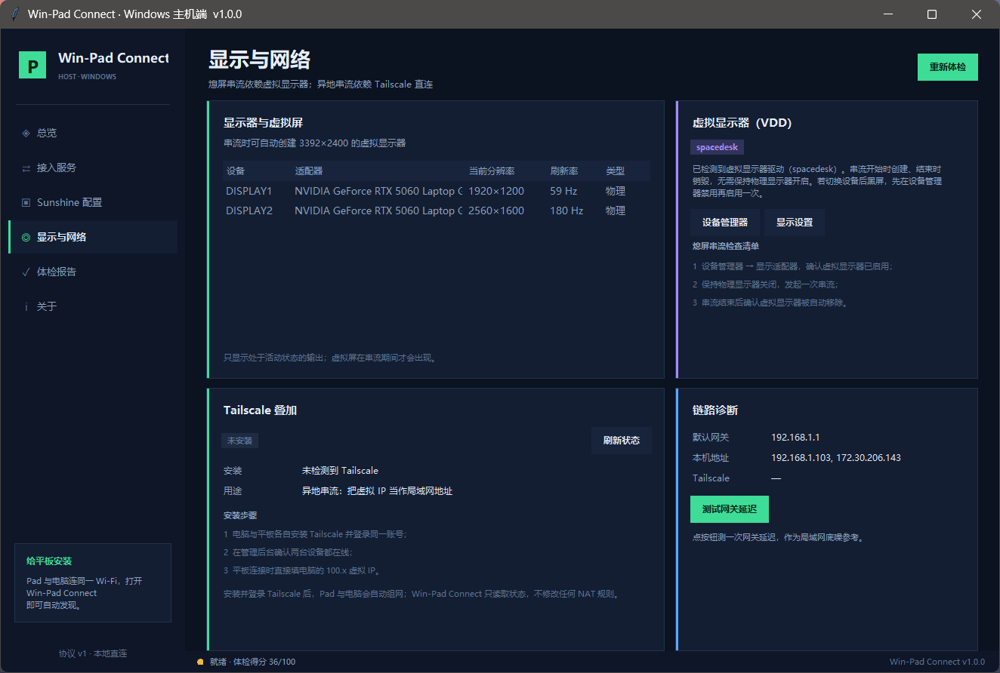
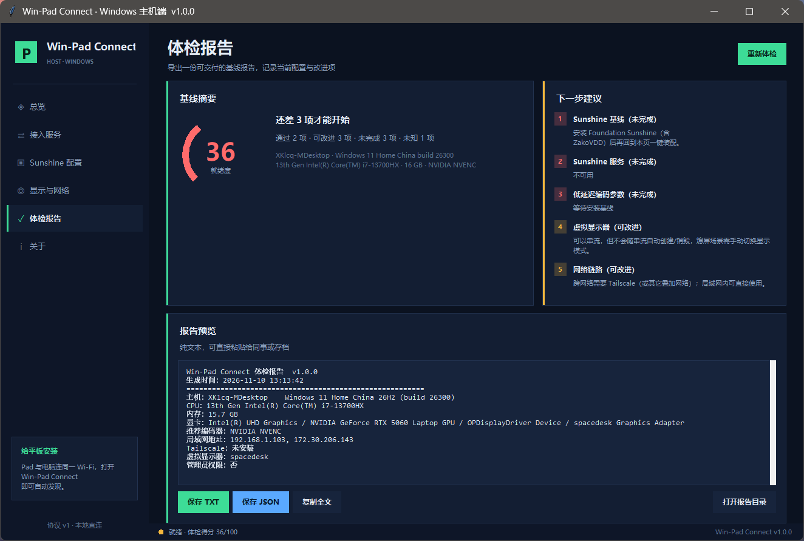

# Win-Pad Connect

**Windows 主机端 · Moonlight / Sunshine 装配台**

Win-Pad Connect 不是新的串流协议，也不替换 Moonlight。它把「把 Windows 电脑配置成一台随时可被平板接管的主机」这件事收进一个桌面程序：

- 体检主机：系统版本、显卡编码器、虚拟显示器、局域网 / Tailscale、防火墙；
- 锁定低延迟编码参数：按 NVENC / QSV / AMF 写入 `sunshine.conf`，改前自动备份，可一键还原；
- 识别 Foundation Sunshine 与 ZakoVDD，提示安装与启用状态；
- 内置接入服务：局域网 UDP 发现 + HTTP 配置下发，平板输入配对码即可拿到分辨率档位与连接信息；
- 导出 TXT / JSON 体检报告，方便排错与交付。

> 串流画面与输入仍由 **Sunshine + Moonlight** 完成。Win-Pad Connect 只做装配、配置与接入，不修改传输协议，不包含任何破解或绕过授权的代码。

## 界面



| 接入服务 | Sunshine 配置 |
| --- | --- |
|  |  |

| 显示与网络 | 体检报告 |
| --- | --- |
|  |  |

## 安装

### 方式一：安装包（推荐）

1. 下载 [`dist/Win-Pad-Connect-Setup-1.0.0.exe`](dist/Win-Pad-Connect-Setup-1.0.0.exe)；
2. 双击安装，默认目录 `%LOCALAPPDATA%\Programs\Win-Pad Connect`；
3. 从开始菜单启动 **Win-Pad Connect**。

源码包：[`dist/Win-Pad-Connect-1.0.0-source.zip`](dist/Win-Pad-Connect-1.0.0-source.zip)（主机端 + 平板端 + 安装器 + 构建脚本 + 文档）。

静默安装：

```bat
Win-Pad-Connect-Setup-1.0.0.exe /S
```

要求：

- Windows 10 22H2 / Windows 11；
- Python 3.10+（安装器不捆绑 Python；启动器会依次查找 `PATH`、`%LOCALAPPDATA%\Programs\Python`、`C:\Python`，也可用环境变量 `WINPAD_PYTHONW` 指定 `pythonw.exe`）；
- 若要真正串流，另装 [Foundation Sunshine](https://github.com/AlkaidLab/foundation-sunshine)（含 ZakoVDD）与 Moonlight 客户端。

### 方式二：从源码运行

```bat
python -m pip install pillow   :: 仅构建图标/安装包时需要
python src\host-windows\run.bat
```

或：

```bat
cd src\host-windows
python -m padlink
python -m padlink --smoke-test
```

### 平板端 APK

- 下载 [`dist/Win-Pad-Connect-Pad-1.0.0.apk`](dist/Win-Pad-Connect-Pad-1.0.0.apk)；
- 要求 Android 8.0+（API 26）；可 `adb install -r Win-Pad-Connect-Pad-1.0.0.apk`，或把 APK 传到平板后点击安装（需允许“未知来源”）；
- 当前 APK 使用 debug 签名，适合自用与内测；公开分发请用自己的 release keystore 重新签名。

从源码重建 APK（需要 Android SDK 34 与 JDK 17）：

```powershell
$env:ANDROID_SDK_ROOT = "$env:LOCALAPPDATA\Android\Sdk"
python scriptsuild-apk.py
```

## 首次配置

1. 打开 **接入服务** 页，确认服务已启动（默认端口 `47800`，配对码 6 位）；
2. 打开 **Sunshine 配置** 页，选择与显卡匹配的编码器，点「应用低延迟配置」（会先备份 `sunshine.conf`）；
3. 打开 **显示与网络** 页，确认虚拟显示器 / Tailscale 状态；
4. 平板与电脑连同一 Wi-Fi，在平板端发现主机并输入配对码；
5. 体检报告页可导出 TXT / JSON 存档。

配置保存在 `%APPDATA%\Win-Pad Connect\settings.json`，备份在 `backups/`，报告在 `reports/`。

## 卸载

开始菜单 → Win-Pad Connect → 卸载，或 Windows 设置 → 应用 → Win-Pad Connect。卸载只删除程序与快捷方式，不会动 `%APPDATA%\Win-Pad Connect` 里的配置与报告。

## 构建安装包

```powershell
powershell -ExecutionPolicy Bypass -File scripts\build-installer.ps1
```

脚本会：

1. 用 `scripts/stage.py` 把 `src/host-windows` 复制到 `build/stage/app`，替换品牌名与数据目录；
2. 用 Pillow 生成 `build/winpad.ico`；
3. 用 .NET Framework 的 `csc.exe` 编译 `Win-Pad Connect.exe`、`Uninstall.exe`；
4. 打包 `build/payload.zip`，再编译内嵌载荷的 `dist/Win-Pad-Connect-Setup-1.0.0.exe`。

产物在 `dist/`。CI 配置见 `.github/workflows/build-installer.yml`。

## 目录

```
Win-Pad Connect/
├─ dist/                 安装包 + 源码包
├─ installer/            C# 安装器、启动器、卸载器源码
├─ scripts/              载荷构建与打包脚本
├─ src/host-windows/     Python 主机端源码（零第三方运行依赖）
├─ src/pad-android/      平板端 Java 源码（发现 / 体检 / 拉起 Moonlight）
├─ docs/                 部署、协议、Moonlight 改造、验收
├─ screenshots/          界面截图
└─ .github/workflows/    自动构建
```

## 与 Moonlight / Sunshine 的关系

- **Sunshine / Foundation Sunshine**：GPL-3.0，编码与串流服务；本项目只读写其官方配置文件，不捆绑、不修改其二进制。
- **Moonlight**：GPL-3.0，客户端；平板端可使用 Moonlight 或配套的 PadLink Pad 工程（本仓库只含主机端，不含 APK）。
- **Tailscale**：BSD-3-Clause，可选的异地组网叠加层；本项目只读取状态，不改 NAT 逻辑。

本项目自身代码以 MIT 发布。若分发包含 GPL-3.0 组件的修改版，需按 GPL-3.0 开源相应修改。

## 作者

- 作者：**lzx_xkzdwb**
- GitHub：<https://github.com/xkzdwb>
- 项目仓库：<https://github.com/xkzdwb/WinPad-Connect>

## 已知边界

- 需要本机已安装 Python；安装包不捆绑解释器；
- 不替代 Sunshine 的编码/串流，也不修改 Moonlight 协议；
- 平板端 APK 为 debug 签名，上架应用商店前需换成 release keystore；本仓库同时包含主机端、平板端源码与 APK 构建脚本。
